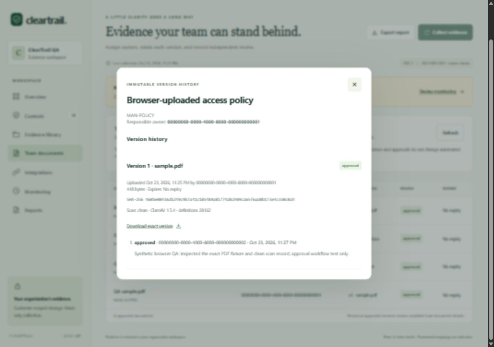
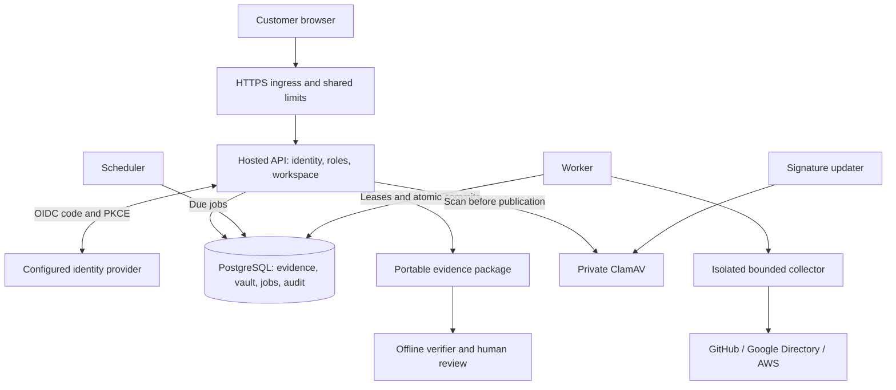

# ClearTrail

**Open-source compliance evidence collection for small teams.**

[](LICENSE)
[](pyproject.toml)
[](cleartrail/__init__.py)
[](https://github.com/AYASKA-in/cleartrail-evidence/actions/workflows/ci.yml)

ClearTrail collects selected security settings from **GitHub, Google Workspace
and AWS**, keeps supporting evidence, and exports portable packages for human
review. Use the local dashboard for one trusted operator, or run the hosted
edition with organization workspaces, OIDC sign-in and independent reviewers.

The core needs no paid API, AI service or proprietary backend. Evidence stays in
storage you operate, and exported packages can be verified offline.

> **Release status: controlled staging, version 0.5.0.** Local regression,
> browser, scanner and recovery results are documented. Production identity,
> provider permissions, infrastructure and independent review still require
> deployment-specific evidence. Read the [release gates](docs/RELEASE_GATES.md)
> before accepting customer data. ClearTrail prepares evidence; it does not
> certify compliance or guarantee auditor acceptance.

[Try the demo](#try-the-demo) · [Deploy hosted](#hosted-deployment) ·
[Documentation](#documentation) · [Contribute](CONTRIBUTING.md) ·
[Security policy](SECURITY.md)

## Contents

- [Why ClearTrail](#why-cleartrail)
- [Capabilities](#capabilities)
- [Choose a deployment mode](#choose-a-deployment-mode)
- [Try the demo](#try-the-demo)
- [Collect from your own accounts](#collect-from-your-own-accounts)
- [Controls and results](#controls-and-results)
- [Team evidence and approvals](#team-evidence-and-approvals)
- [Export and verify evidence](#export-and-verify-evidence)
- [Hosted deployment](#hosted-deployment)
- [Architecture](#architecture)
- [Security model](#security-model)
- [Validation and release readiness](#validation-and-release-readiness)
- [Development](#development)
- [Roadmap](#roadmap)
- [Documentation](#documentation)
- [Community, support and license](#community-support-and-license)

## Why ClearTrail

Small teams need a repeatable way to answer practical questions: which
repositories enforce review, whether account safeguards are enabled, who owns
supporting evidence, and which exact files were approved for an audit review.

ClearTrail provides an inspectable starting point:

- **Transparent checks.** A versioned starter catalog records what each check
  observes and where coverage is incomplete.
- **Honest gaps.** Missing credentials, hidden resources, unsupported settings
  and partial collection stay unknown. They cannot become passing controls.
- **Evidence ownership.** Hosted files retain immutable versions, owners,
  independent decisions, expiry and download history.
- **Portable review.** HTML, CSV, JSON and original approved files leave the
  application in documented packages with offline integrity verification.
- **Operator control.** Run locally or self-host with open-source components.
  There is no mandatory subscription or external telemetry service.

ClearTrail is independently implemented and informed by public Vanta/Drata
workflow documentation. It is not affiliated with those vendors, contains no
vendor backend code or copied product assets, and makes no feature-parity claim.
The [reference investigation](docs/REFERENCE_RESEARCH.md) records the comparison's
sources, observations and limitations.

## Capabilities

| Area | Available in 0.5.0 |
|---|---|
| Collection | Read-only GitHub, Google Directory and AWS checks with explicit scope, bounded requests and incomplete-coverage reporting |
| Local workflow | Standard-library CLI, loopback dashboard, SQLite history and a synthetic demo that contacts no provider accounts |
| Hosted identity | OIDC authorization code flow, S256 PKCE, nonce/state, verified issuer/subject membership and revocable database sessions |
| Organizations | Separate workspaces; administrator, operator and auditor roles; active-workspace mutation checks |
| Monitoring | Opt-in schedules, evidence freshness, durable jobs, missed-run visibility and scoped operational notices |
| Team evidence | Encrypted text/PDF/modern Office uploads, immutable versions, owners, independent review and expiry |
| Scanning | Private ClamAV integration; fresh scan required for binary uploads; scanner errors and limits block publication |
| Review packages | Automated snapshots and document-inclusive period packages with exact approved versions, review history and scan records |
| Integrity | SHA-256 manifests, validated evidence graphs, regenerated views, historical catalogs and offline verification |
| Operations | Explicit migrations, key rotation, readiness checks, isolated collectors, tenant audit chains and recovery runbooks |

## Choose a deployment mode

| | Local CLI and dashboard | Hosted service |
|---|---|---|
| Intended use | One trusted machine/operator | Multiple organization workspaces |
| Persistence | Local SQLite files | PostgreSQL |
| Authentication | Private launch capability exchanged for an expiring browser session | Configured OIDC and explicit workspace membership |
| Provider credentials | Process environment or approved local AWS credential chain | Encrypted workspace vault; AWS role assumption with workspace-bound external ID |
| Files and independent approvals | Not available | Available |
| Collection cadence | On demand | On demand and optional scheduler/worker |
| Dependencies | Python standard library; optional `boto3` for AWS | Hash-locked hosted Python runtime, PostgreSQL and optional ClamAV |
| Exposure | Loopback only | Private API behind operated HTTPS ingress |

**Do not expose the local dashboard as a shared public service.** Use the hosted
application for multiple people or customer organizations.

## Try the demo

Requirements: **Python 3.10+** and Git. The demo requires no provider token,
database server, Node.js installation or additional Python package.

```bash
git clone https://github.com/AYASKA-in/cleartrail-evidence.git
cd cleartrail-evidence
python3 -m cleartrail serve --demo
```

<details>
<summary>Windows PowerShell</summary>

```powershell
git clone https://github.com/AYASKA-in/cleartrail-evidence.git
Set-Location cleartrail-evidence
python -m cleartrail serve --demo
```

</details>

Open the **complete private launch URL printed in the terminal**, including its
`#access=...` fragment. The default port is `8090`; use `--port 8091` if occupied.
Stop the process with `Ctrl+C`.

The capability is exchanged for an expiring HttpOnly session and removed from
the address bar. Treat the launch URL as a secret. Demo data is clearly labeled
synthetic and stored separately in `.cleartrail/demo.sqlite3`. Live collection
uses `.cleartrail/live.sqlite3` by default.

For the optional installed `cleartrail` command, use a virtual environment:

```bash
python3 -m venv .venv
source .venv/bin/activate
python -m pip install -e .
cleartrail --help
```

On Windows, use `.\.venv\Scripts\Activate.ps1` or invoke
`.\.venv\Scripts\python.exe` directly without changing execution policy.

## Collect from your own accounts

1. Copy `config.example.json` to `config.json` using `cp` on Unix or `Copy-Item`
   in PowerShell.
2. Set your organization and enable only the providers you intend to inspect.
   The supplied example enables GitHub and disables Google Workspace/AWS.
3. Supply credentials through an approved process environment or credential
   source. **Configuration files describe scope, not secrets.**
4. Start the live local dashboard:

   ```bash
   python -m cleartrail serve --config config.json --port 8091
   ```

Open the private launch URL from that process. Follow the full
[provider permissions guide](docs/SETUP.md) before using real accounts.

| Provider | Local authorization | Boundary |
|---|---|---|
| GitHub | Approved organization/repository scope and `GITHUB_TOKEN` | Classic default-branch protection; invisible repositories require population review |
| Google Workspace | Intended customer and admin-authorized Directory token through `GOOGLE_ACCESS_TOKEN` | Google sign-in or a generic API key does not authorize Directory collection; token renewal is external |
| AWS | Intended account/region and approved SDK credential source; install `python -m pip install -e ".[aws]"` | Hosted deployments instead require a customer role and generated external ID; collection is not organization-wide |

GitHub and Google local collection use the standard library. AWS requires the
optional `boto3` dependency. Source execution does not automatically load `.env`
files, create provider credentials or refresh Google tokens.

## Controls and results

The frozen starter catalog has **14 controls: 11 automated checks and 3 human
review items**. SOC 2 and ISO 27001:2022 references are partial, indicative mappings,
not complete implementations of those frameworks.

| Source | Checks | What they do not establish |
|---|---|---|
| GitHub — 4 | Organization MFA requirement; approving reviews, status checks and administrator enforcement on default branches | Effective Rulesets, merged-PR history or every production branch |
| Google Workspace — 3 | Active-user 2-step enrollment/enforcement; at least two active super administrators under the local recovery policy | MFA strength, complete privileged-access review or independently validated recovery |
| AWS — 4 | Root MFA account-summary flag; discovered trail logging; four bucket public-access block flags; regional EBS encryption default | Complete logging/event coverage, effective bucket exposure, existing-volume encryption or all regions/accounts |
| Team evidence — 3 | Policy review, access review and incident-response exercise | Independent verification merely because a note or file was uploaded |

| Result | Meaning |
|---|---|
| Pass | The observed setting met this specific check in the recorded scope |
| Fail | A known observation missed the check's policy |
| Unknown | Missing configuration/access, unsupported data, errors or incomplete scope prevents a defensible decision |
| Human review | Supporting notes/files require a qualified person's assessment |

A known failure takes precedence in a rollup; additional unknown scope stays
visible. Percentages use the complete starter catalog, including unconfigured
and human controls. Fresh evidence can still show a failing setting. Neither
freshness nor a high percentage is a compliance conclusion.

See [collection limits](docs/SETUP.md#collection-limits-and-results) for inventory
budgets, request bounds, supported populations and interpretation details.

## Team evidence and approvals

In hosted mode:

1. An administrator/operator uploads evidence, links controls, assigns an owner
   and optionally sets expiry.
2. A different eligible administrator/operator downloads the exact version and
   records a decision and rationale. Uploaders and responsible owners cannot
   approve their own evidence.
3. Replacements create immutable versions and start pending. Earlier bytes and
   decisions remain in history.
4. Auditors can download approved, unexpired versions and export permitted
   selections. They cannot upload, assign owners or review evidence.

Supported files: UTF-8 `.txt`, `.md`, `.csv`, PDF, DOCX, XLSX and PPTX. Binary
uploads require fresh ClamAV scanning and bounded format preflight. Legacy
Office, macro-enabled files, arbitrary archives and executables are rejected.
Files download as attachments and are never previewed/executed inside ClearTrail.
Antivirus does not guarantee that a document is harmless.

| Limit | Bound |
|---|---|
| One file | 512 KiB |
| Original file bytes per workspace | 25 MiB |
| Documents per workspace | 100 |
| Versions per document | 20 |
| Decisions per version | 20; the last slot cannot approve |

Encryption, withdrawal, historical approval, upgrades and quota behavior are in
[Team evidence](docs/TEAM_EVIDENCE.md). These are starter limits, not claims of
enterprise storage capacity.

<details>
<summary>Hosted evidence review screenshot — synthetic QA data</summary>



The local demo does not include this hosted-only workflow.

</details>

## Export and verify evidence

### Automated snapshot packages

This example is fully local and uses synthetic data:

```bash
python -m cleartrail collect --demo --output exports/demo-review-001.zip
python -m cleartrail verify exports/demo-review-001.zip
python -m cleartrail export --demo --output exports/demo-review-002.zip
```

For live collection, replace `--demo` with `--config config.json` on `collect`.
`export` reads the latest saved live snapshot unless `--db` or `--run-id` selects
another source. Export does not refresh provider data. Choose a new output name
each time: publication refuses to overwrite an existing package.

A snapshot ZIP contains `report.html`, `controls.csv`, `run.json`, `evidence.json`,
`manifest.json` and `README.txt`. HTML is printable; use your browser's
Print → Save as PDF when needed. ClearTrail does not generate PDF report binaries.

### Document-inclusive audit packages

In hosted **Reports → Create audit package**, declare a period, select approved
unexpired versions, and optionally include an automated snapshot collected within
that interval. The package contains:

```text
audit-package.zip
├── report.html             # Printable summary and coverage inventory
├── index.json              # Versions, reviews, scans and declared period
├── documents/              # Approved original bytes named by version UUID
├── snapshot.zip            # Optional automated snapshot
├── manifest.json           # File digests and format metadata
└── README.txt              # Handling and verification instructions
```

Verify without extracting or executing contents:

```bash
python -m cleartrail verify-audit audit-package.zip --manifest-sha256 TRUSTED_SHA256
```

Replace `TRUSTED_SHA256` with the manifest digest retained through a separately
trusted channel. Snapshot `verify` also accepts `--manifest-sha256`. Both
verifiers run offline with the standard-library core, validate bounded archives
and evidence relationships, and regenerate report views.

**Manifests are unsigned.** A trusted digest does not establish provider truth,
external reviewer identity, operating effectiveness throughout an audit period or
auditor acceptance. Later withdrawal cannot recall exported files. Packages
contain sensitive evidence; share through an approved channel. See
[audit package semantics](docs/AUDIT_PACKAGES.md).

## Hosted deployment

The hosted edition is an operated application, not a provisioned cloud service.
Before starting it, supply:

- PostgreSQL with separate migration-owner and DML-only runtime roles, both
  without superuser/BYPASSRLS privileges.
- A confidential OIDC web client, an exact HTTPS callback, and explicit verified
  issuer/subject memberships. Google OIDC setup and locally tested Keycloak flows
  are documented; actual identity policy needs deployment validation.
- HTTPS ingress, private database transport, securely delivered secrets, shared
  limits, monitoring/alerts and tested backups.
- Optional private ClamAV and its signature updater for binary evidence.

Follow [HOSTED_DEPLOYMENT.md](docs/HOSTED_DEPLOYMENT.md) in order:

1. Install the hash-locked runtime or build the supplied container image.
2. Copy `.env.hosted.example` to a private environment file and replace every
   placeholder. Source processes read environment variables; Compose loads its
   configured file explicitly.
3. Run the explicit migration using the owner role. Grant runtime permissions
   and bootstrap the first workspace with a verified OIDC issuer/subject. There
   is no public registration, default user or automatic startup migration.
4. Use runtime-role credentials to build/start the services:

   ```bash
   docker compose build
   docker compose up -d api worker scheduler
   ```

5. Route HTTPS ingress to the loopback API and validate real identity/provider
   boundaries before onboarding customers.

Compose does **not** provision PostgreSQL, a domain, TLS or an IdP. Production
settings reject SQLite and non-HTTPS public identity URLs.

For binary files, set `CLEARTRAIL_SCANNER_HOST=clamav`, initialize signatures and
use the `scanning` profile in [SCANNING.md](docs/SCANNING.md). The scanner has a
4 GiB memory limit and its updater 3 GiB; limits are not reserved host capacity.
Measure memory during initial loading and updates. With no scanner configured,
only text uploads are allowed and explicitly labeled unscanned. A configured
but unavailable scanner blocks uploads.

[Google OIDC setup](docs/GOOGLE_STAGING.md) uses a placeholder subdomain and asks
only for `openid` authentication. Sign-in does not authorize Workspace evidence
collection and does not require an AWS account.

## Architecture



PostgreSQL is the hosted persistence and job-queue boundary. Redis and an object
store are not required. File contents are encrypted before PostgreSQL storage.
The separate local CLI uses SQLite and does not start these hosted components.

| Path | Responsibility |
|---|---|
| `cleartrail/connectors.py` | Bounded provider reads and observations |
| `core.py`, `catalog_registry.py` | Collection, control evaluation and historical catalogs |
| `hosted*.py` | Hosted API, OIDC, settings, database, worker, scheduler and administration |
| `document_repository.py`, `documents.py`, `scanning.py` | Evidence lifecycle, authenticated content, format validation and scanner client |
| `reports.py`, `audit_packages.py` | Exports and offline verification |
| `cleartrail/static/` | Browser UI; no Node.js build step |
| `tests/` | Synthetic security, lifecycle, connector, archive and PostgreSQL regressions |
| `deploy/`, `compose.yaml`, `Dockerfile` | Runtime and optional scanner configuration |
| `docs/` | Setup, security boundaries, validation, recovery and roadmap |

Python filenames without a directory prefix in this table live in `cleartrail/`.

## Security model

- **Identity:** OIDC signatures/issuer/audience/nonce, revocable opaque sessions,
  explicit membership, role checks, CSRF and exact Host/Origin boundaries.
  Email and domain claims never grant workspace access.
- **Isolation:** explicit predicates, composite relationships and forced RLS on
  14 scoped PostgreSQL evidence tables. Membership/session control-plane tables
  are scoped by application queries.
- **Secrets:** hosted credentials and files use authenticated tenant-bound
  encryption and a rotating key ring. Read APIs never return stored secret
  plaintext. Metadata such as titles and ownership is not encrypted.
- **Collection:** read-only APIs, explicit account expectations, isolated child
  credential context, restricted environments and execution/output budgets.
  These processes are not sandboxes for untrusted plugins.
- **Files:** bounded parsers/archives, scan-before-publication, authenticated scan
  records, passive attachment downloads and no document execution.
- **Audit:** immutable application version/review history and tenant event hash
  chains. Independently retained anchors are needed against full history rewrites.
- **Runtime:** pinned images, hash-locked dependencies, non-root/read-only
  containers, dropped capabilities and CPU/memory/PID budgets.

The operator, database administrator, IdP and worker host remain trusted. Local
SQLite evidence is not application-encrypted; protect its machine/filesystem.
Back up hosted data and applicable vault keys under separate controls. A database
backup cannot decrypt contents without the corresponding keys.

Read [SECURITY.md](SECURITY.md), [HARDENING.md](docs/HARDENING.md),
[the internal review](docs/SECURITY_REVIEW.md) and [RECOVERY.md](docs/RECOVERY.md).
Report vulnerabilities privately; never attach secrets or customer evidence to
public issues.

## Validation and release readiness

These are **recorded local 0.5.0 results from 23–24 October 2026**, not a guarantee
that another deployment or a future dependency scan will match:

| Check | Recorded result |
|---|---|
| Windows Python 3.10 with PostgreSQL | 347 passed, 2 POSIX-only skips; 259 subtests passed |
| Linux Python 3.12 with PostgreSQL | 349 passed, no skips; 259 subtests passed |
| Real local browser identity | Keycloak code/PKCE, distinct admin/reviewer/auditor, desktop/mobile workflows, restore reauthentication |
| File acceptance | Fresh ClamAV definitions, clean-file workflow, EICAR detection, scan-limit rejection |
| Recovery | Killed worker, separate logical restore, audit/key/file/RLS checks, session invalidation; 81.38-second local rehearsal |
| Release artifacts | Installed-wheel lifecycle, standard-library offline verification and older snapshot compatibility |
| Dependency/image audits | No known matches in audited runtime lock or final app/scanner images at recorded scan times |

The recovery fixture accelerated lease expiry; it did not establish production
RPO/RTO, off-host WAL/PITR or IdP disaster recovery. The internal assessment was
not an independent penetration test. Live customer cloud-provider checks need
authorized accounts/scopes and remain unverified.

CI runs a Windows/Linux Python 3.10/3.12 matrix, a PostgreSQL isolation job,
dependency audits, distribution builds and application/scanner image gates for
known High/Critical vulnerabilities. The badge links to actual GitHub runs.
Dated measurements, tool inventories and limits are in
[VALIDATION.md](docs/VALIDATION.md) and [QA results](docs/qa/results-0.5.json).

## Development

Use Python 3.10+ in a virtual environment:

```bash
python -m pip install --require-hashes -r requirements-hosted.lock
python -m pip install -e ".[dev]"
python -m pytest -q
python -m ruff check cleartrail scripts tests --select F
python -m pip_audit -r requirements-hosted.lock --strict
python -m build
```

PostgreSQL tests require `CLEARTRAIL_TEST_POSTGRES_URL` pointing to an **empty,
disposable database owned by a dedicated non-superuser/non-BYPASSRLS role**.
Tests create data; never target a customer database. Without this variable,
PostgreSQL-specific tests skip. Windows also skips two POSIX-only file tests.
Synthetic fixtures do not establish real provider access.

If Node.js is available, check browser syntax with:

```bash
node --check cleartrail/static/app.js
```

Node.js is a development convenience, not an application runtime requirement.
See [CONTRIBUTING.md](CONTRIBUTING.md) for review expectations, dependency updates,
schema changes and meaningful security regression tests.

## Roadmap

The current scope is deliberately smaller than a full compliance platform.
Priority development areas include:

- GitHub App onboarding and effective Rulesets coverage.
- Durable Google collector authorization/refresh and wider cloud populations.
- Risk, remediation, exceptions, personnel/device/vendor and access-review workflows.
- Engagement-scoped auditor sharing and evidence effective-date semantics.
- Retention, legal holds, offboarding and customer deletion/export automation.
- Continuous re-scanning, storage adapters and approved scanner imports.
- Signed exports, external audit anchors, operational alerting and deployment-specific
  capacity/recovery evidence.

Read the [product gap roadmap](docs/PRODUCT_GAP_ROADMAP.md) for the dated comparison
and [release gates](docs/RELEASE_GATES.md) for launch blockers. Roadmap entries are
opportunities, not delivered features or delivery promises.

## Documentation

| Need | Guide |
|---|---|
| Local credentials, permissions and collection | [SETUP.md](docs/SETUP.md) |
| Hosted roles, migrations and infrastructure | [HOSTED_DEPLOYMENT.md](docs/HOSTED_DEPLOYMENT.md) |
| Google authentication | [GOOGLE_STAGING.md](docs/GOOGLE_STAGING.md) |
| Ownership, reviews, expiry and quotas | [TEAM_EVIDENCE.md](docs/TEAM_EVIDENCE.md) |
| Scanning policy and definitions | [SCANNING.md](docs/SCANNING.md) |
| Audit packages and verification | [AUDIT_PACKAGES.md](docs/AUDIT_PACKAGES.md) |
| Scheduling, freshness and notices | [MONITORING.md](docs/MONITORING.md) |
| Real identity/provider acceptance | [LIVE_VALIDATION.md](docs/LIVE_VALIDATION.md) |
| Backup, key recovery and restore | [RECOVERY.md](docs/RECOVERY.md) |
| Security boundaries and internal review | [HARDENING.md](docs/HARDENING.md), [SECURITY_REVIEW.md](docs/SECURITY_REVIEW.md) |
| Measurements and readiness | [VALIDATION.md](docs/VALIDATION.md), [RELEASE_GATES.md](docs/RELEASE_GATES.md) |
| Research and future scope | [REFERENCE_RESEARCH.md](docs/REFERENCE_RESEARCH.md), [PRODUCT_GAP_ROADMAP.md](docs/PRODUCT_GAP_ROADMAP.md) |

## Community, support and license

Reproducible bug reports, synthetic connector fixtures, documentation improvements
and focused pull requests are welcome. Use
[GitHub Issues](https://github.com/AYASKA-in/cleartrail-evidence/issues) for
non-sensitive bugs/proposals and the [security policy](SECURITY.md) for
vulnerabilities. No dedicated support SLA or audit service is offered.

ClearTrail uses the [MIT License](LICENSE). You may inspect, modify, self-host
and redistribute it subject to that license. Core use requires no paid
ClearTrail subscription or AI API. Hardware, hosting, storage, provider
subscriptions, maintenance and independent audits can still have costs.

SOC 2/ISO 27001 references describe audit-preparation goals. “ISO 27001-lite” is
not a recognized certification. Vendor names belong to their respective owners;
no affiliation or endorsement is implied.
