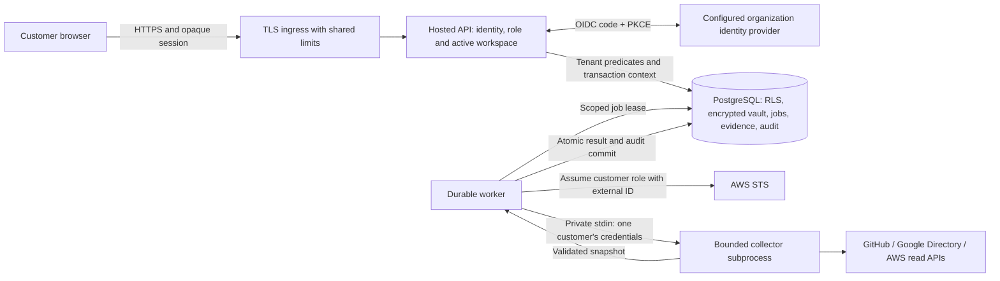

# Hardening assessment — ClearTrail 0.5

Assessment date: 23 October 2026. Target: a self-hosted service serving multiple
customer organizations. This document distinguishes implemented controls from
operational release gates. It is a source review and regression assessment, not
an independent penetration-test certificate or a claim to have found every bug.

## Release decision

**Suitable for local evaluation and a controlled hosted staging deployment. Do
not onboard production customers until the release gates below are evidenced.**
The original unauthenticated local prototype was not suitable for public hosting.
The hosted service now has a separate authentication and persistence boundary;
the local CLI remains useful without installing the hosted dependencies.

## Findings and implemented work

| Area | Gap found | Implemented control | Remaining work / priority |
|---|---|---|---|
| Public access | Sensitive local API reads lacked authentication | Loopback capability exchange, expiring cookies, CSRF, exact Host/Origin checks; hosted API uses OIDC and database sessions | Verify real IdP policy and TLS ingress before launch — P0 |
| Customer isolation | One SQLite workspace cannot safely represent a SaaS | Hosted PostgreSQL repository, explicit tenant predicates, composite keys/FKs, forced RLS on evidence, credentials, notes, revisions, jobs and audit | Local PostgreSQL RLS/concurrency/migration tests pass; execute release CI and independent tenant-boundary review — P0 |
| Identity | No organization identity or member model | Authorization code + S256 PKCE, nonce/state, issuer/audience/signature/expiry validation; explicit issuer/subject memberships | Real IdP integration, MFA requirements and IdP outage/recovery exercise — P0 |
| Authorization | No read-only auditor role | Admin/operator/auditor checks, transaction-time write permission checks, last-admin protection, membership rechecked each request | Periodic access certification, customer offboarding and SSO lifecycle automation — P1 |
| Browser workspace confusion | Two tabs can target different workspaces while sharing one session | Every hosted mutation requires a workspace header matching the session's active workspace | Exercise with multiple real browser profiles — P1 |
| Secrets | Environment-only credentials do not scale across customers | Authenticated Fernet envelopes bind tenant and provider; rotating key ring, revocation UI, hash-only session capabilities; no secret read API | Managed secret delivery, KMS envelope keys, backup/key recovery and rotation exercise — P0 |
| Collector credentials | Shared process environment could mix accounts | Private subprocess stdin, isolated home/config, allowlisted environment, no parent environment mutation, output secret checks | Infrastructure egress policy and hardened worker execution platform — P0 |
| AWS confused deputy | Ambient SDK credentials alone do not establish intended scope | Hosted assumed roles with a service-generated, workspace-bound unique external ID; expected account pin, STS identity check, S3 expected owner, endpoint override disabled | Customer-specific trust-policy review, live permission test — P0 |
| Provider scope | Hidden repositories or ambiguous Google customer could create false confidence | Expected GitHub repository list, strict organization/repository identity, explicit hosted Google customer ID, bounded population | GitHub App installation flow, rulesets, Google refresh-token/service identity workflow, AWS organization/multi-region coverage — P1 |
| Evidence semantics | Malformed upstream data could look successful | Strict booleans/populations/identities, partial coverage remains unknown, generic error records, bounded retries and request budgets | Signed provider fixtures and recurring live integration canaries — P1 |
| Evidence integrity | Rehashing a forged report could pass a file-only check | Hash-pinned historical catalogs, v1-to-v2 migration, scope provenance, record/graph validation and version-aware regenerated HTML/CSV verification | Detached signing and independent immutable storage/anchors — P1 |
| Team evidence | No file ownership, independent approval or immutable file history | Schema 4: encrypted tenant-bound text/PDF/Office uploads with fresh AV scans, exact-version independent decisions, expiry, quotas, stale-form rejection, RLS and safe audited downloads | Image evidence, retention and engagement-scoped sharing — P1 |
| Archive handling | Untrusted ZIP members and decompression could exhaust resources | Bounded central directory and members, duplicate/path/type checks, compression/size limits, strict JSON, no extraction | Fuzzing with a larger archive corpus — P1 |
| File output | A failed export or concurrent overwrite could corrupt reports | Fully generated bundle, private temp file, fsync, atomic no-clobber publication | Platform-specific backup/restore and filesystem fault injection — P1 |
| Collection lifecycle | Thread-only jobs vanished on restart | Transactional queue, opt-in schedules, missed-run coalescing, freshness/projection checks, scoped notices, single flight, leased isolated jobs and atomic result commits | Worker heartbeat/SLO dashboards, deployment drain and recovery under load — P0 |
| Auditability | No durable record of configuration/permission changes | Tenant hash chains for memberships, configurations, credentials, notes and collections; CLI external-head comparison | Forward events/head anchors to independently controlled immutable storage; export/read-access audit events — P0 |
| Data lifecycle | No SaaS retention/deletion/restore policy | Snapshot quota, daily collection quota, immutable notes revisions, local verified SQLite backup | Customer retention, legal-hold decisions, deletion/export workflow, encrypted PostgreSQL PITR and proven restore — P0 |
| Resource abuse | Unbounded threads, requests and provider calls | Local worker/body/header/socket bounds; hosted body/deadline/burst limits; database quotas; container CPU/memory/PID bounds | Shared ingress rate/connection limits, load and soak tests, measured capacity — P0 |
| Supply chain | No locked hosted dependencies or CI | Hash-pinned runtime, pinned base images/actions, vulnerability audit, Windows/Linux test matrix and PostgreSQL job, source allowlist | Linux image build and non-root/read-only smoke pass; execute hosted CI, automated update review and signed release provenance — P0/P1 |
| Framework completeness | Starter checks are far below a full SOC 2/ISO program | Explicit starter catalog and collection windows; manual notes remain unverified | Risk register, policies, personnel/device/vendor controls, audit-period evidence, exception review and auditor validation — P1 |

P0 means a customer-launch blocker; P1 means subsequent product/security work.
Priority does not imply a confirmed exploitable vulnerability remains in each row.

## Trust boundaries

The hosted operator, database administrator, IdP administrator and worker runtime
are trusted. A subprocess isolates credential context; it is **not a sandbox for
untrusted plugins**. RLS protects accidental unscoped queries; SQL injection with
arbitrary transaction-setting access, a superuser, or stolen service secrets
requires broader infrastructure defenses. Tenant metadata/membership/session
tables are control-plane tables scoped by application queries rather than RLS.
Do not share the runtime database role with customers or analytical tools.

## Required launch evidence

1. Pass the complete CI matrix, real PostgreSQL tests and container build using
   the deployment artifacts committed for the release. Prove the runtime role
   cannot bypass RLS; prove a pooled connection loses its prior tenant context.
2. Complete a real OIDC authorization-code flow with the chosen IdP, including
   MFA, wrong issuer/audience, expired/replayed code, revoked member and logout.
3. Use two separate organizations/accounts for every enabled provider. Exercise
   inaccessible resources, expired credentials, pagination/rate limits and a
   deliberately wrong AWS account. No production credentials were used here.
4. Terminate a worker during collection, restore PostgreSQL and vault keys into a
   separate environment, verify audit anchors, and recover jobs without creating
   a successful snapshot for a failed or expired lease. Define measured RPO/RTO.
5. Configure TLS, private database access, certificate verification, shared
   ingress limits, DNS/egress restrictions and secrets management. Disable query
   logging for OIDC callbacks and never log cookies or Authorization headers.
6. Load-test realistic tenant/resource populations and verify queue latency,
   memory bounds, quotas and noisy-neighbor behavior. Add operational alerting.
7. Obtain an independent application/infrastructure security review and auditor
   review of sample evidence. Agree customer terms, retention and incident
   handling before accepting real customer data.

## Regression approach

Tests cover token signatures/claims offline, tenant reads and exports, roles,
membership revocation, CSRF, workspace switching, credential context/rotation,
queue leases, stored-record/audit tampering, subprocess environment separation,
timeouts, provider malformed responses, local HTTP abuse and bundle attacks.
Provider APIs use mocks, not real account credentials. PostgreSQL tests are
explicitly skipped unless `CLEARTRAIL_TEST_POSTGRES_URL` is supplied. Windows
skips two POSIX-only file tests. See [VALIDATION.md](VALIDATION.md) for the actual
run results, which should be refreshed with each release.

Security design references: [OpenID Connect validation](https://openid.net/specs/openid-connect-core-1_0.html#IDTokenValidation),
[PostgreSQL RLS](https://www.postgresql.org/docs/current/ddl-rowsecurity.html),
[OWASP sessions](https://cheatsheetseries.owasp.org/cheatsheets/Session_Management_Cheat_Sheet.html),
[OWASP CSRF](https://cheatsheetseries.owasp.org/cheatsheets/Cross-Site_Request_Forgery_Prevention_Cheat_Sheet.html).

## 0.3 implementation update

Recurring monitoring, bounded in-app notices and compatibility migration are implemented; see [MONITORING.md](MONITORING.md). The complete suite passed on Windows Python 3.10 and Linux Python 3.12 with a real disposable PostgreSQL 17.11 database. This closes the prior local PostgreSQL/container-execution gaps, not the live customer IdP/provider, independent-review, external-alerting, PITR/restore or measured-capacity gates. Current results are in [VALIDATION.md](VALIDATION.md).

## 0.5 implementation update

PDF/Office scan-before-publication, authenticated scan records, approved-version
audit-period packages and offline verification are implemented. Real Keycloak
browser QA, PostgreSQL logical restore with worker termination, a bounded local
read-load exercise, dependency audit and final image scans passed. Google-specific
callback metadata is bounded and never trusted for membership. The selected
Google/subdomain setup remains to be provisioned. Earlier table priorities describe
broader production obligations, not a claim that this local work proves an SLA.
See [RELEASE_GATES.md](RELEASE_GATES.md) for current completion and external gates,
[SECURITY_REVIEW.md](SECURITY_REVIEW.md) for internal review scope, and
[VALIDATION.md](VALIDATION.md) for exact measurements.
